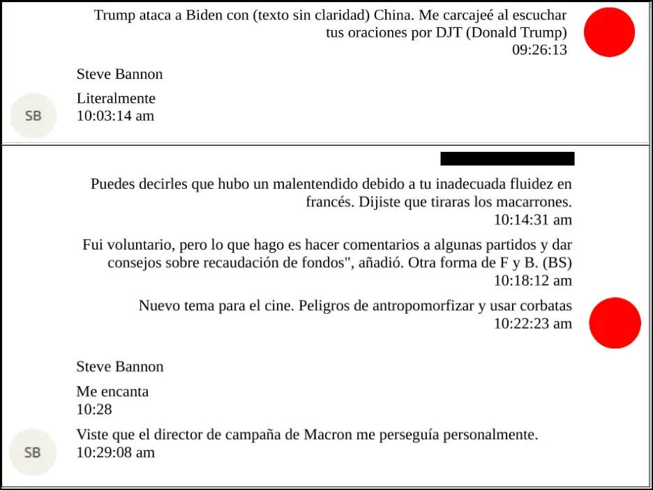
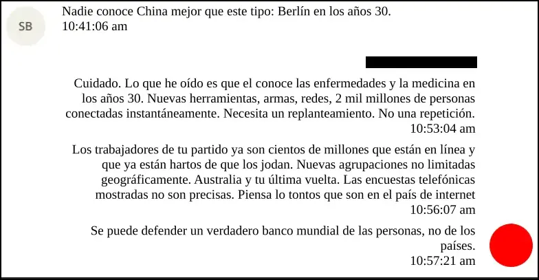
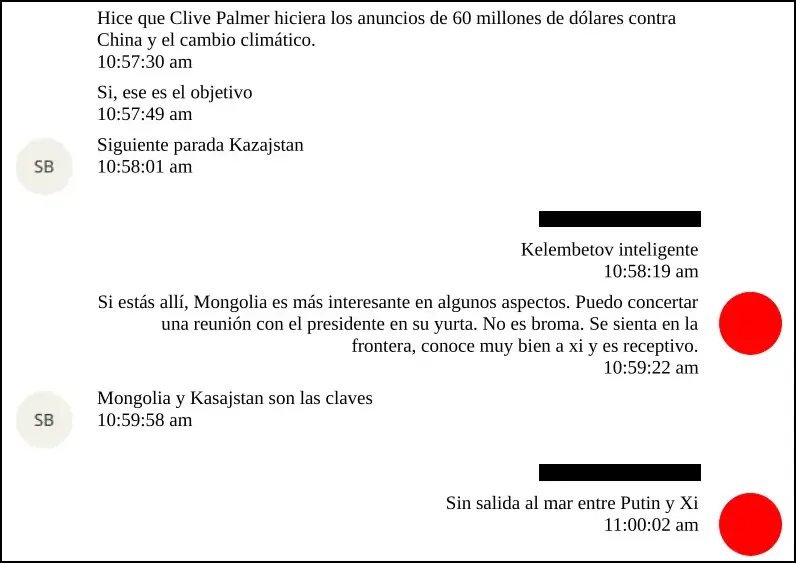

## Documento DOJ: EFTA01615861
<Notice type="info" title="Fecha documento">20 de mayo del 2019</Notice>
<Notice type="info" title="Fecha de los sucesos">20 de mayo del 2019</Notice>

### Contexto
Steve Bannon (estratega político de ultraderecha en EEUU, ex asesor de D. Trump y fundador de “The Movement”) en una 
conversación con Jeffrey Epstein sobre estrategias de intervencionismo internacional, como con Francia, Mongolia, Kazajistán,
China y Rusia.

En la imagen anterior, podemos ver cómo Epstein intercedería por Bannon por una frase dicha por éste último, donde parece haber
ofendido al Presidente de Francia en ese entonces, Emmanuel Macron. 

En esta imagen, Epstein le plantea a Bannon que deben utilizar internet para controlar la opinión de millones de personas que siguen a Bannon.

Y por último, en esta parte de la conversación, hablan sobre intervenir mediante publicidad pagada (60 millones de dólares) contra el cambio
climático y China, donde especifican que además deben intervenir en Mongolia y Kasajstan para que no existan rutas directas terrestres entre
Rusia y China.

### Opinión

<Notice type="warning" title="Importante">
Recuerda que esta opinión es personal, por lo que puedo incluir suposiciones o hechos no estrictamente verificables en ella
y puede estar sujeta a cambios.
</Notice>
Con este chat, logro detectar que existe una relación estrecha entre Steve Bannon y Epstein, que busca interferir en la política internacional
buscando beneficios para sus grupos políticos, ya sea comprando la opinión pública mediante negacionismo y además debilitando relaciones
entre China y Rusia con el objetivo de que no puedan competir económicamente con Estados Unidos y sus aliados.
La relación de Bannon y Epstein no está documentada solamente en este chat, en futuros artículos analizaremos otros documentos relacionados, 
para comprender que esto no es una conversación aislada.

### Fuentes
<a href="https://www.justice.gov/epstein/files/DataSet%2010/EFTA01615861.pdf" target="_blank">
<Button text="Documento original" size="md" color="blue" variant="solid" /></a>
<a href="https://mega.nz/file/kMVEzCSI#cMj9qFPSWU4lwG7WCBV_oYiGokyaMm_baym9jNbrfzg" target="_blank">
<Button text="Respaldo del original" size="md" color="green" variant="solid" /></a>
<a href="https://mega.nz/file/kVUySALS#WQSCT6di5pFV51BA-I9CUVxThgo5fZrdPutH60BWUvw" target="_blank">
<Button text="Documento en español" size="md" color="red" variant="solid" /></a>