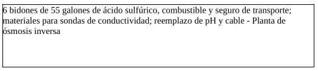

## Documentos DOJ: EFTA01223564 y EFTA00164551
<Notice type="info" title="Fecha documento">a</Notice>
### Contexto
Se especula sobre una factura de compra de ácido sulfúrico el mismo día (06 de diciembre del 2018) que el FBI investigaría a Epstein.
Al leer el contexto completo de la factura, efectivamente la fecha coincide con el día de la investigación y es correcto que está nombrado 
el ácido sulfúrico, pero también es correcto que el ácido se usa en los filtros de agua de mar.
Nota personal (no objetiva): Respecto al ácido. no quita que podría comprar unos galones “extra” para ese día en particular. Por otro lado, 
que el Departamento de Justicia haya censurado los nombres de quienes se comunican en la mayoría de los archivos es una obstrucción a la justicia.

asd

Aasd

### Opinión

<Notice type="warning" title="Importante">
Recuerda que esta opinión es personal, por lo que puedo incluir suposiciones o hechos no estrictamente verificables en ella
y puede estar sujeta a cambios.
</Notice>
asd

### Fuentes
<a href="URL" target="_blank">
<Button text="Documento EFTA01223564" size="md" color="blue" variant="solid" /></a>
<a href="URL" target="_blank">
<Button text="Respaldo de EFTA01223564" size="md" color="green" variant="solid" /></a>
<a href="URL" target="_blank">
<Button text="Documento en español" size="md" color="red" variant="solid" /></a>

<a href="URL" target="_blank">
<Button text="Documento EFTA00164551" size="md" color="blue" variant="solid" /></a>
<a href="URL" target="_blank">
<Button text="Respaldo de EFTA00164551" size="md" color="green" variant="solid" /></a>
<a href="URL" target="_blank">
<Button text="Documento en español" size="md" color="red" variant="solid" /></a>