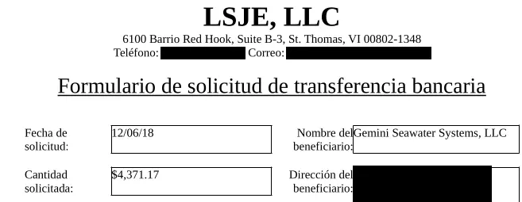
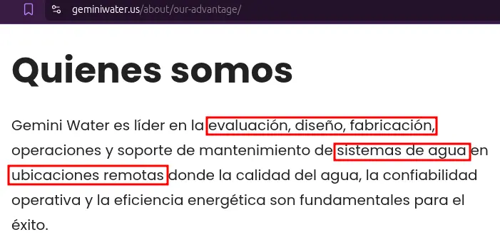
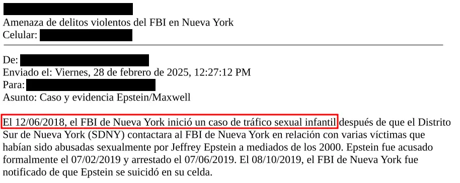

## Documentos DOJ: EFTA01223564, EFTA00794317 y EFTA00164551
<Notice type="info" title="Fecha documento">06 de diciembre del 2018</Notice>
### Contexto
En este caso se especula sobre una factura de compra de ácido sulfúrico emitida el mismo día (06 de diciembre del 2018) que el FBI investigaría a Epstein.
Al leer el contexto completo de la factura, efectivamente está nombrado el ácido sulfúrico: 

sin embargo también es correcto que el ácido se usa en los filtros de agua de mar. Revisé el sitio web del proveedor y efectivamente es su nicho de negocio:

Y al revisar el documento EFTA00164551, se evidencia que la fecha calza con el inicio de la investigación, lo que sería un punto a favor de esta hipótesis
que indicaría que se usó el ácido sulfúrico para deshacerse de evidencia crucial para la resolución de esta investigación.

Ahora ahora, no he encontrado otra evidencia adicional relevante.

### Opinión

<Notice type="warning" title="Importante">
Recuerda que esta opinión es personal, por lo que puedo incluir suposiciones o hechos no estrictamente verificables en ella
y puede estar sujeta a cambios.
</Notice>
Respecto al ácido, para una mente criminal como la de Epstein, no me resulta extraña la idea de que se deshaciciera de evidencia o víctimas con este 
elemento por lo que podría comprar unos galones “extra” para ese día en particular, aunque afirmarlo tajantemente no es responsable, aún.

### Fuentes
<a href="https://www.justice.gov/epstein/files/DataSet%209/EFTA01223564.pdf" target="_blank">
<Button text="Documento EFTA01223564" size="md" color="blue" variant="solid" /></a>
<a href="https://mega.nz/file/kc8TnLqD#5I8jTMzZg0daV6lQ3rjiQpHg_zDlR-ymzJhSdI5UpkM" target="_blank">
<Button text="Respaldo de EFTA01223564" size="md" color="green" variant="solid" /></a>
<a href="https://mega.nz/file/JEk31bBL#ohcp6i5LODn0ayGCpdMnxKm1immnVPf9G_f18vDJTfc" target="_blank">
<Button text="Documento en español" size="md" color="red" variant="solid" /></a>

<a href="https://www.justice.gov/epstein/files/DataSet%209/EFTA00164551.pdf" target="_blank">
<Button text="Documento EFTA00164551" size="md" color="blue" variant="solid" /></a>
<a href="https://mega.nz/file/xRNkRRQY#00yvj4ehRZ6axPnNF0JY-z0XS7bw750uALqTG9EL5kk" target="_blank">
<Button text="Respaldo de EFTA00164551" size="md" color="green" variant="solid" /></a>
<a href="https://mega.nz/file/IU9yVI7T#fRecg9c19Klv1Hvx9v7yGyGFw_Y-xN2RUzNBmzhUgnc" target="_blank">
<Button text="Documento en español" size="md" color="red" variant="solid" /></a>

<a href="https://www.justice.gov/epstein/files/DataSet%209/EFTA00794317.pdf" target="_blank">
<Button text="Documento EFTA00164551" size="md" color="blue" variant="solid" /></a>
<a href="https://mega.nz/file/xRNkRRQY#00yvj4ehRZ6axPnNF0JY-z0XS7bw750uALqTG9EL5kk" target="_blank">
<Button text="Respaldo de EFTA00164551" size="md" color="green" variant="solid" /></a>
<a href="https://mega.nz/file/IU9yVI7T#fRecg9c19Klv1Hvx9v7yGyGFw_Y-xN2RUzNBmzhUgnc" target="_blank">
<Button text="Documento en español" size="md" color="red" variant="solid" /></a>