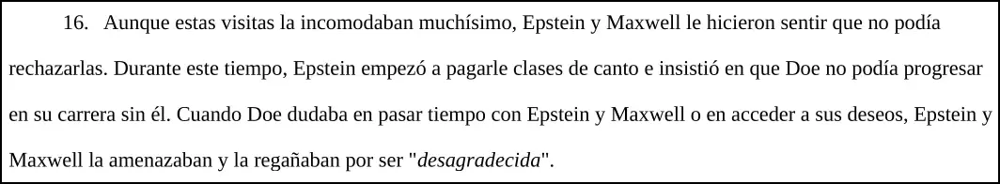
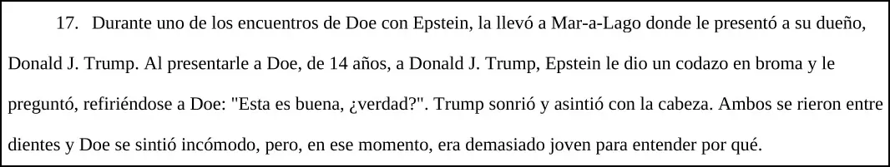

## Documento DOJ: EFTA00019101
<Notice type="info" title="Fecha documento">16 de Enero del 2020</Notice>
<Notice type="info" title="Fecha de los sucesos">Año 1994</Notice>
### Contexto
Redacción de uno de los juicios contra Epstein. ***“Jane Doe”*** es un nombre ficticio utilizado en audiencias judiciales para 
ocultar el nombre real de una víctima. ***Doe*** indica que conoció a Epstein a los 13 años en 1994, siendo reclutada por 
**Ghislane Maxwell** (pareja de Epstein) aprovechándose de las vulnerabilidades sociales y familiares de sus víctimas
(abusadas previamente, padres alcohólicos, etc) para convencerlas de que en la vida no obtendrán una mejor vida si no es
con ellos:

Epstein pagó colegiaturas entre otros gastos para “amarrar” a sus víctimas a cumplir con cualquier orden. Durante uno de 
los encuentros de Doe con Epstein, la llevó a un evento en una mansión propiedad de **Donald Trump** llamada Mar-a-lago 
donde Doe estaba siendo presentada a él, su nuevo “dueño”:

### Opinión
Si bien una denuncia no es suficiente para determinar culpabilidades, ésta no es la única denuncia contra Trump, y por 
otro lado, otros antecedentes, como los múltiples vuelos a la isla, la constante comunicación con Epstein, etc, implican
que Trump no es un desconocido para Epstein, por lo que te recomiendo revisar las demás acusaciones en su contra.

<Notice type="warning" title="Importante">
Recuerda que esta opinión es personal, por lo que puedo incluir suposiciones o hechos no estrictamente verificables en ella
y puede estar sujeta a cambios.
</Notice>

### Fuentes
<a href="https://www.justice.gov/epstein/files/DataSet%208/EFTA00019101.pdf" target="_blank">
<Button text="Documento original" size="md" color="blue" variant="solid" /></a>
<a href="https://mega.nz/file/RdNnBA6b#zkAIdkZTokvdAjqUjUjdIWsa4z0K90QkiY8TXzpWnoE" target="_blank">
<Button text="Respaldo del original" size="md" color="green" variant="solid" /></a>
<a href="https://mega.nz/file/Ec9C3CSa#nKrO8PSgUqqa-90F8_kQIYJNtJ6wLmotYyWf_3ELIUA" target="_blank">
<Button text="Documento en español" size="md" color="red" variant="solid" /></a>