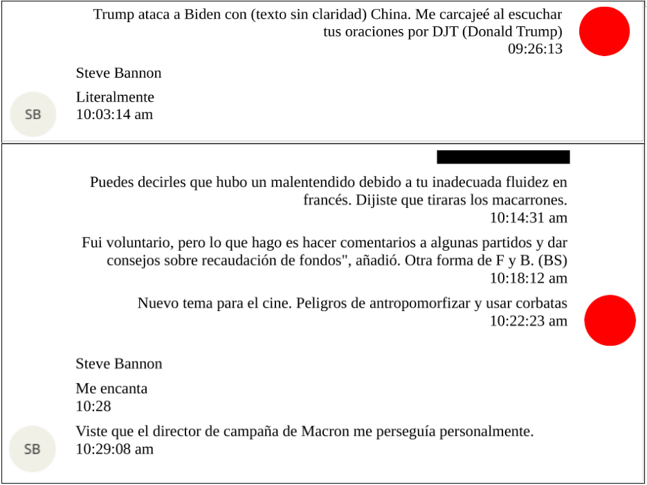
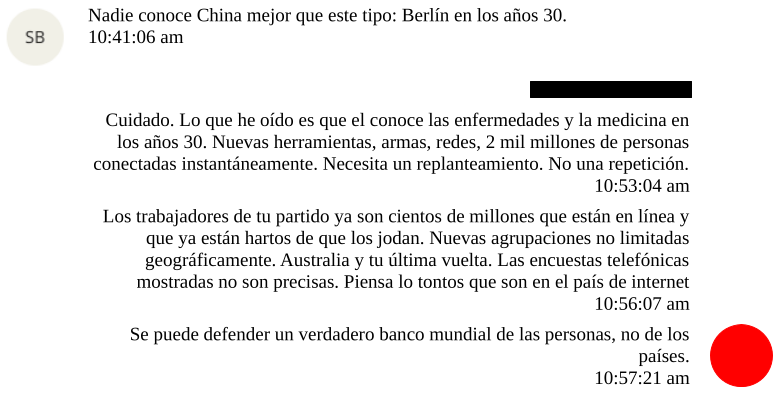
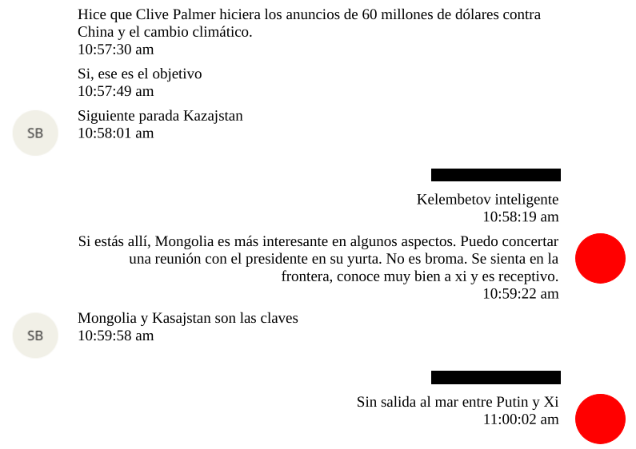

## Documento DOJ: EFTA01615861
<Notice type="info" title="Fecha documento">21 de enero del 2021</Notice>
### Contexto
Steve Bannon (estratega político de ultraderecha en EEUU, ex asesor de D. Trump y fundador de “The Movement”) en una 
conversación con Jeffrey Epstein sobre estrategias de intervencionismo internacional, como con Francia, Mongolia, Kazajistán,
China y Rusia.

### Opinión

<Notice type="warning" title="Importante">
Recuerda que esta opinión es personal, por lo que puedo incluir suposiciones o hechos no estrictamente verificables en ella
y puede estar sujeta a cambios.
</Notice>

### Fuentes
<a href="https://www.justice.gov/epstein/files/DataSet%2010/EFTA01615861.pdf" target="_blank">
<Button text="Documento original" size="md" color="blue" variant="solid" /></a>
<a href="https://mega.nz/file/kMVEzCSI#cMj9qFPSWU4lwG7WCBV_oYiGokyaMm_baym9jNbrfzg" target="_blank">
<Button text="Respaldo del original" size="md" color="green" variant="solid" /></a>
<a href="https://mega.nz/file/kVUySALS#WQSCT6di5pFV51BA-I9CUVxThgo5fZrdPutH60BWUvw" target="_blank">
<Button text="Documento en español" size="md" color="red" variant="solid" /></a>