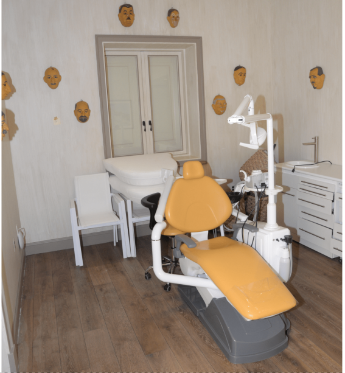
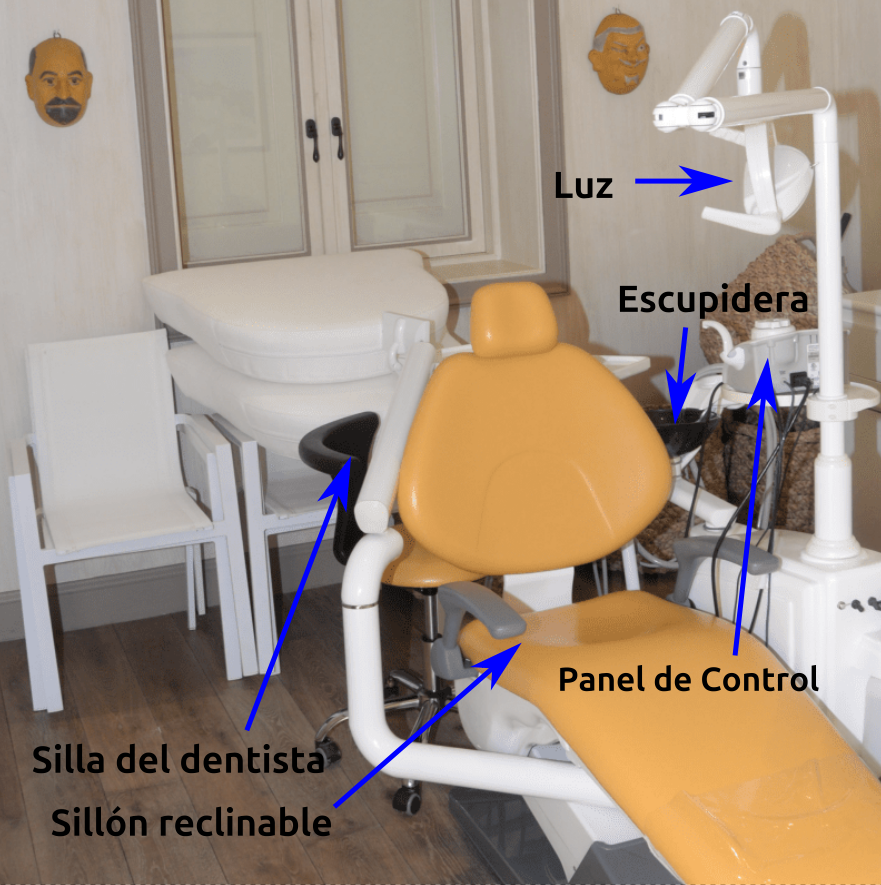
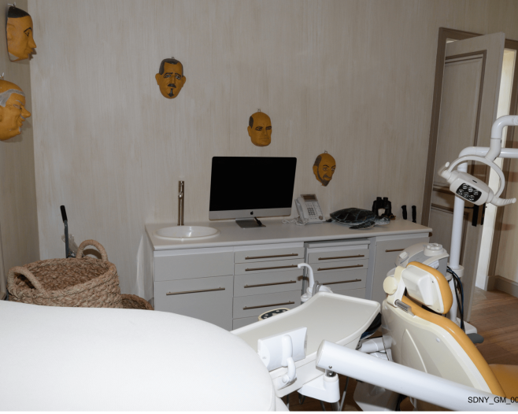
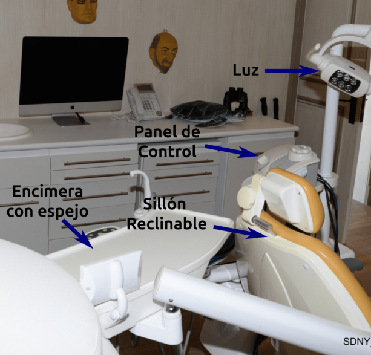

## Documentos DOJ: EFTA01303309 y EFTA01303429
<Notice type="info" title="Fecha documento">21 de enero del 2021</Notice>
### Contexto
En una de las residencias de Epstein se encontró una sala de odontología, que estaba equipada hasta con un lavamanos. 
Se desconoce el motivo de la existencia de esta sala, aunque PODRÍA estar vinculado con la hipótesis de que a abusados se 
les extraía sus piezas dentales para que "no mordieran" al realizar sexo oral.

### Opinión

<Notice type="warning" title="Importante">
Recuerda que esta opinión es personal, por lo que puedo incluir suposiciones o hechos no estrictamente verificables en ella
y puede estar sujeta a cambios.
</Notice>

### Fuentes
<a href="https://www.justice.gov/epstein/files/DataSet%2010/EFTA01303309.pdf" target="_blank">
<Button text="Documento EFTA01303309" size="md" color="blue" variant="solid" /></a>
<a href="https://mega.nz/file/oVViyRIQ#-GiUOqRROjbB_8k3QnJJv9rYhhqcA6GdJhk09oT8avY" target="_blank">
<Button text="Respaldo de EFTA01303309" size="md" color="green" variant="solid" /></a>
  
  
<a href="https://www.justice.gov/epstein/files/DataSet%2010/EFTA01303429.pdf" target="_blank">
<Button text="Documento EFTA01303429" size="md" color="blue" variant="solid" /></a>
<a href="https://mega.nz/file/EYlx3STb#xx7Dat8Tf9jCtzxSIz8hVHxg1cYSXZB7M5XzzV1B_HM" target="_blank">
<Button text="Respaldo de EFTA01303429" size="md" color="green" variant="solid" /></a>