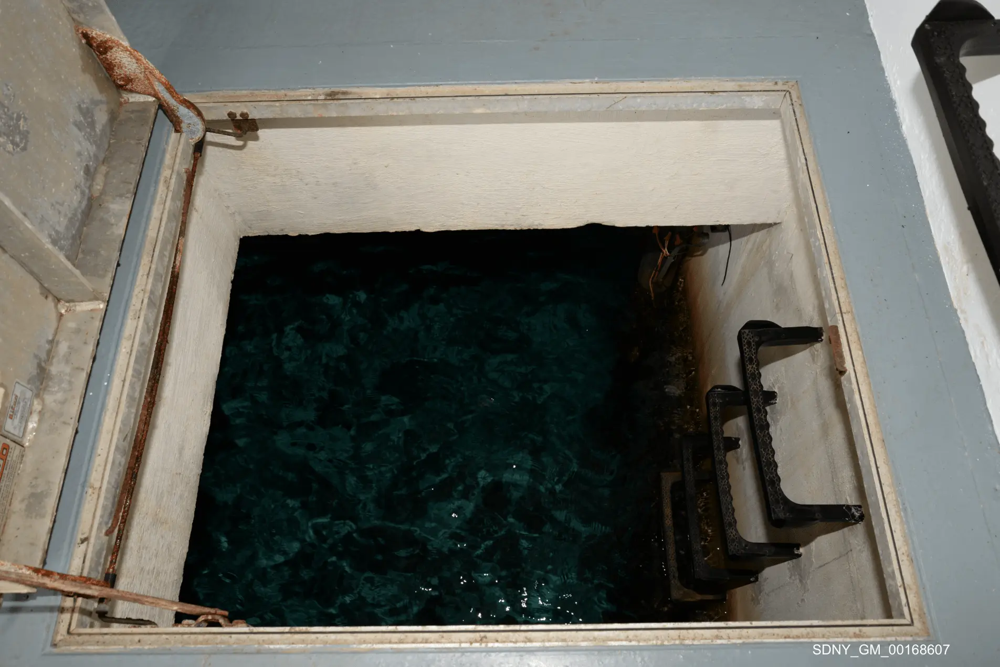
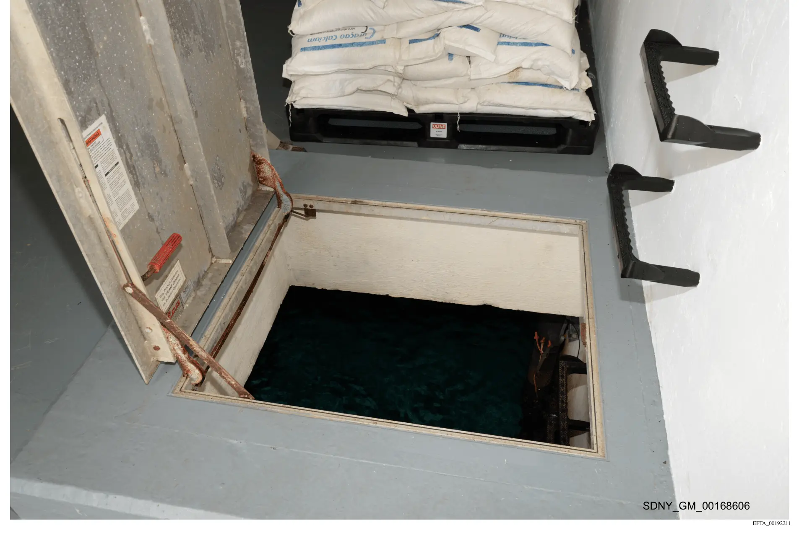
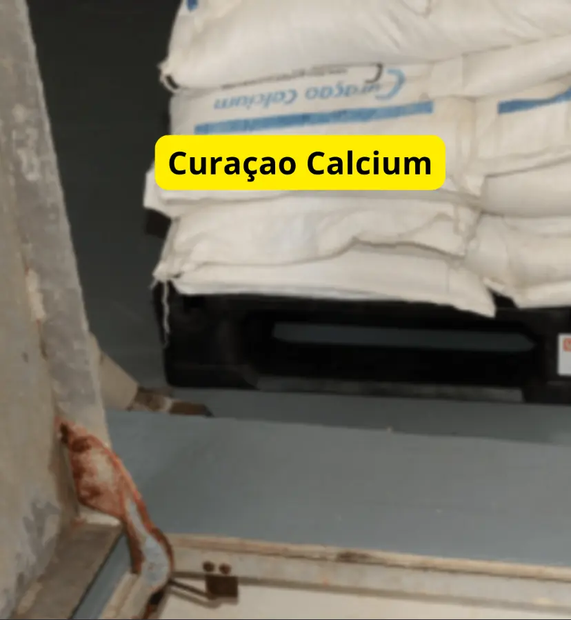
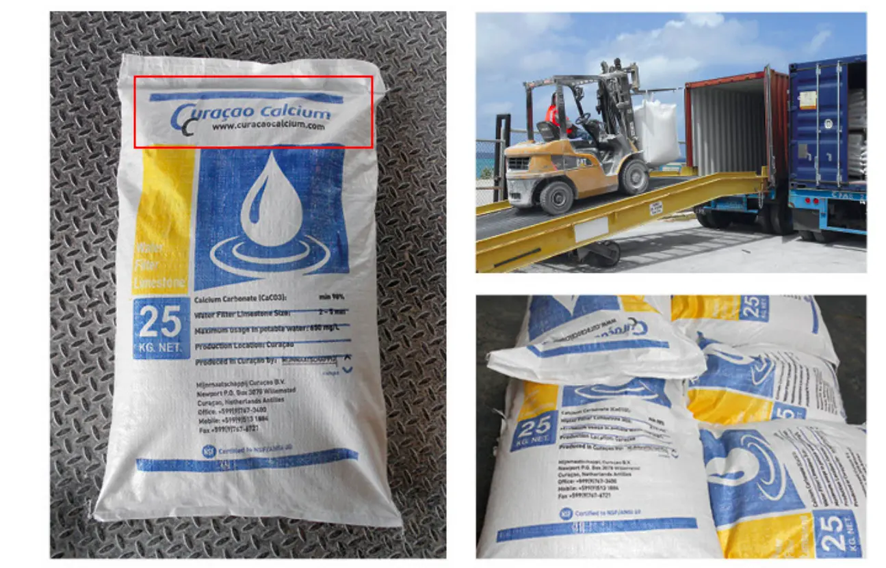

## Documentos DOJ: 
<Notice type="info" title="Fecha documento">No identificada en el archivo</Notice>
### Contexto
Existe la hipótesis de que esta escotilla ubicada en la mansión de la isla ***Little Saint James*** de Epstein apunta hacia el mar y servía para deshacerse
de cadáveres.
En el documento EFTA01341287 se aprecia esta escotilla, pero a pesar de la cercanía de la foto, no podría afirmar con certeza si el fondo del agua es de una
base sólida (como una cisterna), roqueríos (en la playa) o el fondo del mar (en alguna parte de la residencia que esté adentarado el mar).

Sin embargo, el documento EFTA01303579, que muestra la misma escotilla, desde un ángulo más general de la escotilla, se visualizan varios sacos que tienen 
la marca **Curaçao Calcium**, así que decidí averiguar de qué producto se trataba.

Al verificar el producto en internet, es producto es carbonato de calcio (CaCO3) utilizado en sistemas de filtrado de agua de mar, por lo que esto indicaría que
esta escotilla está en la entrada de una cisterna de filtrado de agua, pero como las otras fotos no me dan claridad de que dónde estén ubicadas estas escotillas, 
ni otra cosa más, viniendo de Epstein, 

Descripción del producto: (Traducido literalmente):
> La piedra caliza de Curazao es un carbonato de calcio (CaCO3) de gran pureza, proveniente de la montaña Mesa. Este depósito marino de calcio se formó de manera
ininterrumpida a lo largo de millones de años, en un entorno de agua marina muy clara y en condiciones de gran aridez. La ausencia de sedimentos fluviales u 
otros minerales, como el hierro, permitió que el depósito se formara sin alteraciones. Esto confiere a este carbonato de calcio unas características únicas: 
un contenido muy elevado de CaCO3 (99%), un color sumamente blanco y una excelente solubilidad en comparación con otros productos de piedra caliza.
> #### Uso de la piedra caliza
> La piedra caliza se emplea para diversos fines. Se utiliza ampliamente para ajustar el pH del agua en el tratamiento de piscinas; asimismo, es necesaria para
neutralizar la acidez del agua y reducir la corrosión en tuberías y redes de distribución provocada por el agua ácida. La piedra caliza se utiliza en filtros
de postratamiento. Nuestra piedra caliza se disuelve por completo en agua potable desalinizada, lo que garantiza unos filtros limpios y unos costes de
mantenimiento muy reducidos. Además, la piedra caliza aporta nutrientes beneficiosos al agua potable y mejora el sabor del producto final.
**— Mijnmaatschappij Curacao (MMC), also known as The Curacao Mining Company).**

### Opinión

<Notice type="warning" title="Importante">
Recuerda que esta opinión es personal, por lo que puedo incluir suposiciones o hechos no estrictamente verificables en ella
y puede estar sujeta a cambios.
</Notice>
Diría que es una teoría plausible y con una lógica, sin embargo, sería necesario contar con más antecedentes como para realizar una afirmación como ésta,
pero definitivamente es un punto de partida que es necesario investigar a fondo, por que por la evidencia en otros archivos, si pensaría que Epstein fue capaz
de cometer atrocidades de este nivel con algunas de sus víctimas.

### Fuentes
<a href="https://www.justice.gov/epstein/files/DataSet%2010/EFTA01303579.pdf" target="_blank">
<Button text="Documento EFTA01303579" size="md" color="blue" variant="solid" /></a>
<a href="https://mega.nz/file/oVViyRIQ#-GiUOqRROjbB_8k3QnJJv9rYhhqcA6GdJhk09oT8avY" target="_blank">
<Button text="Respaldo de EFTA01303579" size="md" color="green" variant="solid" /></a>

<a href="https://www.justice.gov/epstein/files/DataSet%2010/EFTA01341287.pdf" target="_blank">
<Button text="Documento EFTA01341287" size="md" color="blue" variant="solid" /></a>
<a href="https://mega.nz/file/EYlx3STb#xx7Dat8Tf9jCtzxSIz8hVHxg1cYSXZB7M5XzzV1B_HM" target="_blank">
<Button text="Respaldo de EFTA01341287" size="md" color="green" variant="solid" /></a>

<a href="https://miningcompanycuracao.com/products/all-products/" target="_blank">
<Button text="Sitio Web Curacao" size="md" color="blue" variant="solid" /></a>
<a href="https://mega.nz/file/9RdhgL6K#8888FSZnWdouCSG8fToK6YaOLnBlQH3i3VgXdybv-dw" target="_blank">
<Button text="Respaldo de Sitio Web Curacao" size="md" color="green" variant="solid" /></a>

<a href="https://miningcompanycuracao.com/wp-content/uploads/2014/05/FolderCurac%CC%A7aoCalcium2016.pdf" target="_blank">
<Button text="Foto del saco de CaCO3" size="md" color="blue" variant="solid" /></a>
<a href="https://mega.nz/file/1ANTyTAL#57crNa45gwC0qU6UN88cRAAAAAAAAAAAuRqHAundsxg" target="_blank">
<Button text="Respaldo de foto del saco de CaCO3" size="md" color="green" variant="solid" /></a>