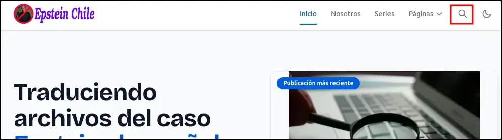
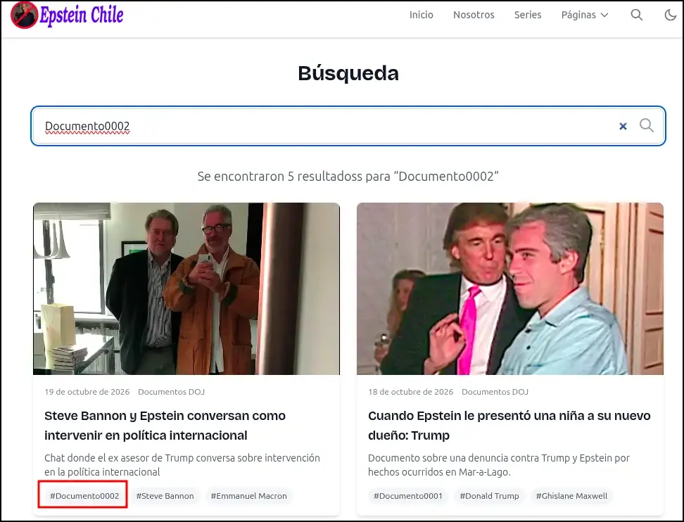
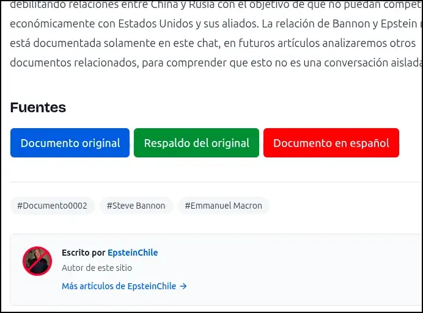

### Contexto: 
Como hay varias redes sociales que no permiten la inserción de enlaces en sus plataformas, he decidido generar etiquetas de fácil lectura
en todas las publicaciones:

Con esta etiqueta puedes encontrar el artículo relacionado en este sitio web, donde primero deberás ir al buscador del sitio web:

Aquí escribes la etiqueta, y te aseguras que se trate de ella:

Una vez entras al artículo, podrás obtener mayores detalles de la publicación y al final de cada uno, encontrarás las 
fuentes que respaldan dicha publicación:

Como puedes apreciar, se publica el enlace original del contenido utilizado, el enlace del respaldo de ese contenido, y el enlace de su
traducción al español. 

Para que este caso sea tomado en serio, los divulgadores también debemos tomarnos en serio la búsqueda y análisis de
la evidencia, seleccionando información realmente útil y por sobretodo, indicando las fuentes de su información. 
<Notice type="warning" title="Importante">
Mi ojetivo no es que creas ciegamente lo que publico, mi objetivo es que te informes y verifiques por tí mismo de una manera sencilla.
</Notice>
Te agradecería un montón si sigues las cuentas de redes sociales que están en el inicio de este sitio compartes su contenido, ya que la mayoría de
redes sociales restringen y limitan el alcance del contenido relacionado con el caso, ¡muchas gracias!

