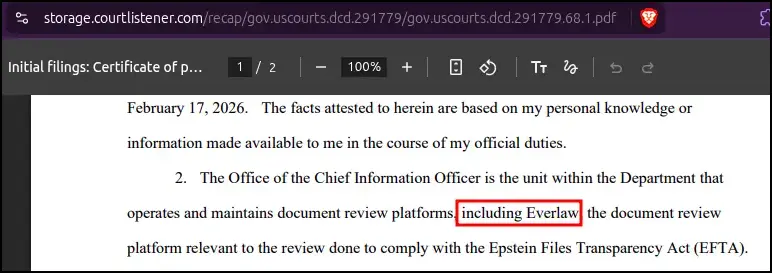
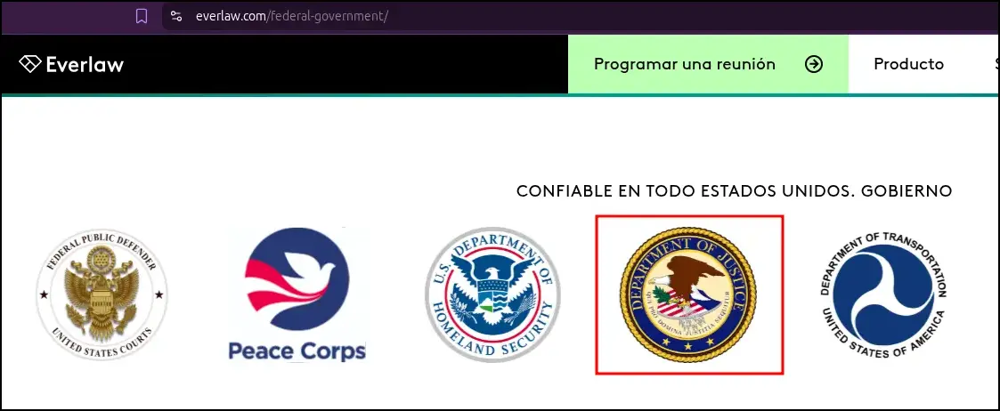
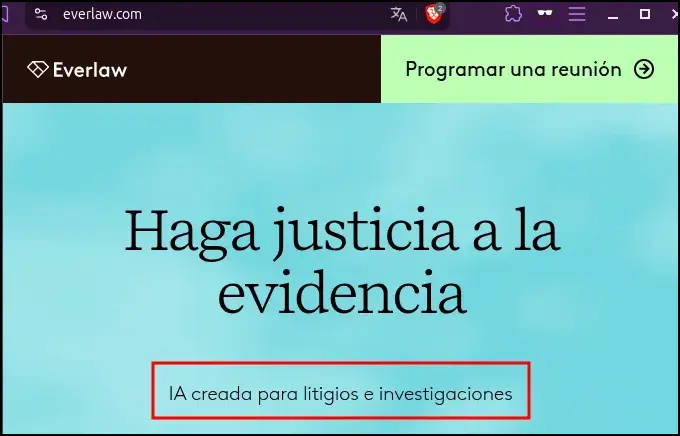

import { YouTube } from '@astro-community/astro-embed-youtube';

### Contexto: 
La abogada Katie Phang ([@katiephang](https://www.instagram.com/katiephang/) en Instagram), quien en este momento se encuentra en proceso de una demanda en
contra del Departamento de Justicia de Estados Unidos por la censura en los documentos de Epstein, nos da su última actualización que trata sobre la 
utilización de agentes de Inteligencia Artificial en la investigación, ya que nombran a la empresa llamada ***Everlaw***.

En el mismo video, muestra el sitio web de [Everlaw](https://www.everlaw.com/federal-government/) es posible dilucidar fácilmente que el Departamento de
Justicia efectivamente es cliente de Everlaw:

Y que Everlaw es un producto de Inteligencia Artificial, creado para litigios:

lo que permite concluir que efectivamente esta herramienta realmente hizo el trabajo inicial de decidir qué archivos sería puestos al público y cuáles no.
Ve el video completo aquí:
<YouTube id="jKqPp43f5vE" />

### Opinión

<Notice type="warning" title="Importante">
Recuerda que esta opinión es personal, por lo que puedo incluir suposiciones o hechos no estrictamente verificables en ella
y puede estar sujeta a cambios.
</Notice>
Que hayan admitido que usaron IA para la investigación, estaría explicando porqué existen censuras absurdas, negligencia absoluta en la censura de víctimas, 
y censuras deliberadas de victimarios. Hecha por tierra el "gran esfuerzo" que supuestamente han hecho por impartir justicia por este caso. Pagan una IA y se 
autocondecoran por no tener ni un mínimo de respeto por la sociedad. Esto solo me hace apuntar en una dirección: corrupción en su grado máximo. Encubrimiento
de esferas tan y más altas que las suyas.

### Fuentes
<a href="https://storage.courtlistener.com/recap/gov.uscourts.dcd.291779/gov.uscourts.dcd.291779.68.1.pdf" target="_blank">
<Button text="Demanda 1:26-cv-01417 Doc 68.1" size="md" color="blue" variant="solid" /></a>
<a href="https://mega.nz/file/dNdmwKxR#5yUZE6hVCZTT7Oq5MdLnea2WyeHGsWOOpXxGmzjG1zA" target="_blank">
<Button text="Respaldo de Demanda" size="md" color="green" variant="solid" /></a>
<a href="https://mega.nz/file/NYtnCKwQ#He0ir-UQhRwnwfALlES6tAR75EPmeoRIBB9eyn5RYq0" target="_blank">
<Button text="Documento en español" size="md" color="red" variant="solid" /></a>

<a href="https://www.everlaw.com/federal-government/" target="_blank">
<Button text="Sitio Web Everlaw" size="md" color="blue" variant="solid" /></a>
<a href="https://mega.nz/file/dRlyUIYS#i4WYQ744biX0C0y_jWAnVUJECMdUPXDvUnX7ok13iQw" target="_blank">
<Button text="Respaldo de Demanda" size="md" color="green" variant="solid" /></a>
<a href="https://mega.nz/file/BMc3iKJJ#ogBkzTWM4wvJHdEh1hlEoz2Sd71w0GjYSJjxKzLPfnc" target="_blank">
<Button text="Documento en español" size="md" color="red" variant="solid" /></a>